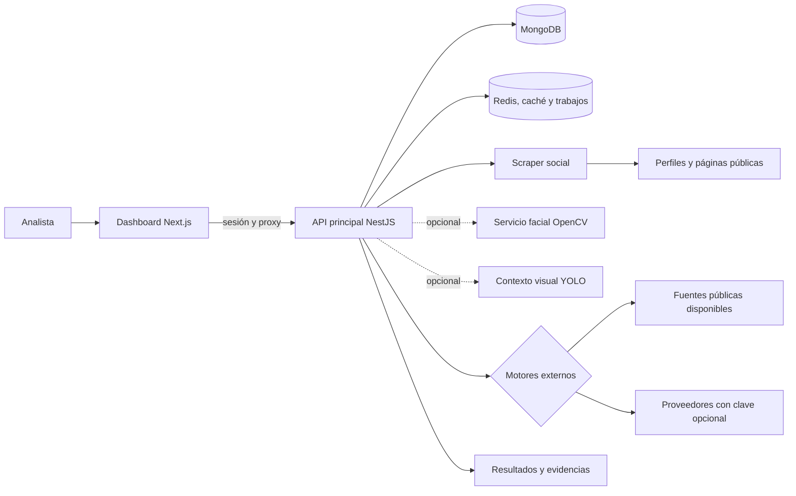

# Reverse Image Engine — OSINT Deco

<p align="center">
  
</p>

[](LICENSE)


Motor OSINT de búsqueda inversa de imágenes y descubrimiento de perfiles públicos en redes sociales. Reúne una interfaz web, una API de orquestación, un scraper social y dos servicios auxiliares de análisis visual.

**Desarrollado y publicado por [deco31416.com](https://deco31416.com).** Licencia MIT; consulta [LICENSE](LICENSE) y los avisos de cada componente.

> Usa la herramienta solo en investigaciones autorizadas y respeta la legislación, privacidad y términos de uso de cada fuente. Los resultados son pistas que requieren verificación; una coincidencia visual no demuestra identidad.

## Componentes

| Directorio | Responsabilidad | Puerto local |
| --- | --- | ---: |
| `dashboard-osint` | Interfaz Next.js, sesión y proxy del backend | 3003 |
| `micro-ts-osint` | API NestJS, búsquedas, investigaciones, usuarios y evidencias | 7105 |
| `osint-social-scraper` | Búsqueda/resolución de perfiles públicos y gestión de assets | 7110 |
| `face-biometric-service` | Detección y comparación facial local con OpenCV | 7120 |
| `visual-context-service` | Detección local de objetos/contexto con YOLO | 7130 |

El dashboard llama al backend; el backend integra el scraper y, cuando se configuran, los servicios visuales. El scraper también puede ejecutarse por separado.

## Arquitectura y flujo



## Claves y dependencias externas

Las claves de Google, Bing, Serper, Tavily, Brave, RapidAPI, Groq, Gemini, Hugging Face y Cloudinary habilitan integraciones opcionales. Sin ellas, las funciones de esos proveedores quedan deshabilitadas o ofrecen resultados reducidos. Los crawlers de perfiles públicos y algunos motores nativos no requieren una clave de proveedor, pero dependen de cambios, disponibilidad y límites impuestos por los sitios.

Para usar el backend completo se requiere MongoDB. Redis se utiliza para caché y trabajos en cola. La autenticación y la comunicación entre servicios requieren secretos propios de cada instalación; no son claves de proveedores y nunca se deben publicar. Genera valores aleatorios, guárdalos solo en archivos locales `.env` y no reutilices los valores de ejemplo.

## Requisitos

- Node.js 20 o posterior.
- Yarn 4 para los servicios NestJS y pnpm para el dashboard.
- Python compatible con las dependencias fijadas en los `requirements.txt`.
- MongoDB para usuarios, investigaciones y persistencia del backend.
- Redis para caché y colas del backend.
- Chromium/Puppeteer para las funciones que automatizan navegador o generan PDF.

Los modelos de visión pueden ser archivos grandes o tener licencias propias. No se incluyen como parte de la licencia MIT del código: sigue las instrucciones de cada servicio para obtenerlos y revisa sus condiciones.

## Inicio local

No hay un archivo Docker Compose en la raíz; cada servicio se instala y ejecuta por separado. Antes de empezar, instala Node.js 20+, Yarn 4, pnpm, Python 3.11+, MongoDB y Redis. Usa PowerShell desde la raíz del repositorio.

### 1. Preparar configuración privada

Crea los archivos locales desde las plantillas vacías:

```powershell
Copy-Item .\micro-ts-osint\.env.example .\micro-ts-osint\.env
Copy-Item .\osint-social-scraper\.env.example .\osint-social-scraper\.env
Copy-Item .\dashboard-osint\.env.example .\dashboard-osint\.env.local
Copy-Item .\face-biometric-service\.env.example .\face-biometric-service\.env.local
Copy-Item .\visual-context-service\.env.example .\visual-context-service\.env.local
```

Configura MongoDB y Redis en el backend. Genera JWT_SECRET con un valor aleatorio (por ejemplo: node -e "console.log(require('node:crypto').randomBytes(32).toString('hex'))"), define OSINT_INITIAL_OWNER_USERNAME y OSINT_INITIAL_OWNER_PASSWORD, y establece la misma clave interna en ambos lados de cada conexión. Para usar las funciones visuales, configura sus claves internas en los servicios Python y en el backend. Las claves de proveedores externos son opcionales. No publiques los archivos creados.

### 2. Instalar y compilar los servicios Node

```powershell
Push-Location .\micro-ts-osint
yarn install
yarn build
Pop-Location

Push-Location .\osint-social-scraper
yarn install
yarn build
Pop-Location

Push-Location .\dashboard-osint
pnpm install
Pop-Location
```

### 3. Preparar los servicios Python (opcional)

Instala cada servicio en su propio entorno virtual:

```powershell
Push-Location .\face-biometric-service
python -m venv .venv
.\.venv\Scripts\python -m pip install -r requirements.txt
.\scripts\download-models.ps1
Pop-Location

Push-Location .\visual-context-service
python -m venv .venv
.\.venv\Scripts\python -m pip install -r requirements.txt
.\.venv\Scripts\python -c "from ultralytics import YOLO; YOLO('yolov8n.pt')"
Pop-Location
```

La descarga de pesos puede requerir aceptar y cumplir las licencias de los modelos. Los pesos no se versionan en este repositorio. Descárgalos antes de construir las imágenes Docker: el Dockerfile facial copia los modelos ONNX y el visual copia `yolov8n.pt`.

### 4. Iniciar

Para iniciar backend, scraper y dashboard en desarrollo, abre terminales separadas:

```powershell
cd .\micro-ts-osint
yarn start:dev
```

```powershell
cd .\osint-social-scraper
yarn start:dev
```

```powershell
cd .\dashboard-osint
pnpm dev
```

Para iniciar los servicios Python manualmente, usa una terminal por servicio con su `.venv` activado y el archivo `.env.local`:

```powershell
cd .\face-biometric-service
.\.venv\Scripts\Activate.ps1
uvicorn app.main:app --host 127.0.0.1 --port 7120 --env-file .env.local
```

```powershell
cd .\visual-context-service
.\.venv\Scripts\Activate.ps1
uvicorn app.main:app --host 127.0.0.1 --port 7130 --env-file .env.local
```

Como alternativa en Windows, después de compilar Node y preparar ambos entornos Python, ejecuta `.\scripts\start-local-stack.ps1 -DashboardDev` desde la raíz. El lanzador usa procesos ocultos y escribe logs locales en `.runtime/`.

Direcciones por defecto:

- Dashboard: http://localhost:3003
- API principal: http://localhost:7105/api/v1
- Scraper social: http://localhost:7110/api/v1
- Servicio facial: http://localhost:7120
- Contexto visual: http://localhost:7130
## Documentación

- [Dashboard](dashboard-osint/README.md)
- [API principal](micro-ts-osint/README.md)
- [Scraper social](osint-social-scraper/README.md)
- [Social Intel](micro-ts-osint/docs/SOCIAL_INTEL.md)
- [Configuración del servicio facial](face-biometric-service/)
- [Configuración del servicio visual](visual-context-service/)

Cada servicio tiene su propio `.gitignore` para reglas locales; el `.gitignore` de la raíz cubre secretos y artefactos comunes a todo el monorepo.

## Licencia

El código de este monorepo se distribuye bajo MIT por **deco31416.com**. Los modelos, dependencias y servicios externos conservan sus propias licencias y condiciones. Lee [LICENSE](LICENSE) antes de redistribuir.