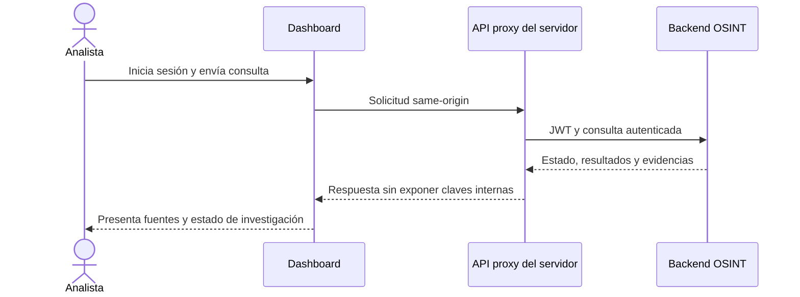

# Reverse Image Engine — OSINT Deco · Dashboard

[](LICENSE)


Interfaz web Next.js para operar el motor OSINT. Se conecta al backend NestJS mediante rutas proxy del servidor; las credenciales internas no se entregan al navegador.

**Desarrollado y publicado por [deco31416.com](https://deco31416.com).** Licencia MIT: [LICENSE](LICENSE).

## Funciones

- Búsqueda OSINT por datos de texto y, según la configuración disponible, imagen.
- Vistas de Rostros, Social Intel, evidencias, red y configuración.
- Gestión de casos, evidencias y usuarios con permisos del backend.
- Sesión mediante cookie HTTP-only y proxy de API en el servidor.
- Adaptación de resultados de las integraciones conectadas; la disponibilidad depende del backend y sus proveedores.

## Flujo de solicitud



## Arquitectura

```text
Navegador → Dashboard :3003 → proxy del servidor → Backend :7105
                                                  ├─ Scraper social :7110
                                                  ├─ Servicio facial :7120 (opcional)
                                                  └─ Contexto visual :7130 (opcional)
```

## Requisitos e inicio

Requiere Node.js 20+, pnpm y un backend configurado. Desde la raíz del monorepo:

```powershell
cd .\dashboard-osint
pnpm install
Copy-Item .env.example .env.local
pnpm dev
```

Abre http://localhost:3003. En `.env.local`, establece `OSINT_API_BASE` y la URL pública del dashboard según el entorno. La autenticación se realiza con usuarios creados en el backend; no configures credenciales de administrador fijas en este archivo. Consulta [.env.example](.env.example).

Para compilar y ejecutar las pruebas del dashboard:

```powershell
pnpm run build
pnpm test
```

## Variables sensibles

- No añadas el prefijo `NEXT_PUBLIC_` a secretos.
- Mantén `MICROSERVICES_API_KEY`, claves internas y credenciales fuera del navegador.
- Usa HTTPS y orígenes CORS restringidos en despliegues públicos.
- No uses valores de demostración como contraseñas ni claves de producción.

## Licencia y atribución

MIT por [deco31416.com](https://deco31416.com). El aviso de copyright y los términos completos están en [LICENSE](LICENSE). Las dependencias conservan sus licencias.