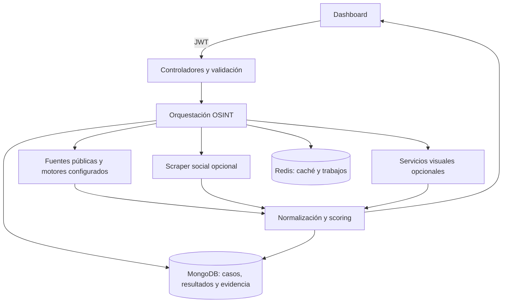

# Reverse Image Engine — OSINT Deco · API principal

[](LICENSE)


Backend NestJS que recibe solicitudes del dashboard, orquesta búsquedas OSINT, gestiona investigaciones y evidencias, y se integra con el scraper social y servicios visuales opcionales.

**Desarrollado y publicado por [deco31416.com](https://deco31416.com).** Licencia MIT: [LICENSE](LICENSE).

## Arquitectura de una investigación



## Responsabilidades

- API REST bajo `/api/v1`, autenticación JWT y gestión de usuarios/roles.
- Orquestación de búsquedas de texto, perfil y análisis inverso de imágenes.
- Persistencia de investigaciones, resultados, evidencias y datos de Datasec en MongoDB.
- Caché y trabajos de larga duración mediante Redis.
- Integración opcional con el scraper social, servicios faciales y servicio de contexto visual.
- Conectores opcionales a motores de búsqueda, IA y almacenamiento de imágenes.

La disponibilidad de cada motor depende de sus variables de entorno y de los límites de cada proveedor. Sin claves externas, se omiten las funciones que dependan de ellas; el software no incorpora credenciales de terceros. Los conectores nativos/crawlers también dependen de cambios y bloqueos de las fuentes públicas.

## Requisitos

Node.js 20+, Yarn 4, MongoDB y Redis. Para las funciones visuales, configura los servicios Python por separado. Chromium/Puppeteer se requiere en las funciones que usan navegador o generan PDF.

## Inicio

```powershell
cd .\micro-ts-osint
yarn install
Copy-Item .env.example .env
```

Completa `.env` con secretos nuevos y URL locales o desplegadas. `JWT_SECRET` y las credenciales del Owner inicial deben ser valores propios, aleatorios y privados. Para invocar servicios internos, las claves configuradas en ambos extremos deben coincidir. No publiques archivos `.env`.

```powershell
yarn start:dev
```

Base local: `http://localhost:7105/api/v1`. En desarrollo, Swagger puede habilitarse con `ENABLE_SWAGGER=true`; no lo expongas públicamente sin revisar su acceso.

## Pruebas y compilación

```powershell
yarn build
yarn test
yarn test:e2e
```

## Configuración

Consulta [.env.example](.env.example), [Social Intel](docs/SOCIAL_INTEL.md), [Quickstart](docs/QUICKSTART.md) y [CONTRIBUTING.md](CONTRIBUTING.md). Las claves de Google, Bing, Serper, Tavily, Brave, Gemini, Groq, Hugging Face, RapidAPI y Cloudinary son opcionales por integración. MongoDB, Redis y secretos de autenticación son requisitos locales según las funciones habilitadas.

## Licencia

MIT por [deco31416.com](https://deco31416.com). Ver [LICENSE](LICENSE). Los servicios, modelos y dependencias externos se rigen por sus propias licencias.