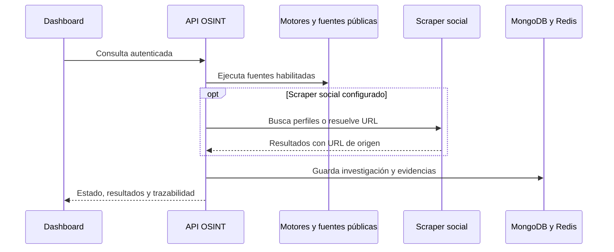

# Módulo OSINT de Reverse Image Engine

Este módulo implementa las rutas de investigación del backend: creación y consulta de búsquedas, orquestación de fuentes, resultados y evidencias. La API se publica bajo `/api/v1` y requiere la autenticación configurada por el servicio principal.

## Flujo de datos

## Capacidades

- Consultas por nombre, usuario, datos asociados e imagen, según las opciones de la solicitud.
- Orquestación de motores nativos, crawlers y proveedores externos configurados.
- Descubrimiento de perfiles sociales y comunicación opcional con `osint-social-scraper`.
- Persistencia, scoring, trazabilidad y gestión de evidencias mediante el backend.

Las fuentes y proveedores disponibles dependen de la configuración. Una clave ausente desactiva la integración correspondiente; no se sustituye con una credencial incluida en el código. Revisa [Social Intel](../../docs/SOCIAL_INTEL.md) y [la configuración del backend](../../README.md).

## Claves y datos

Las claves de proveedores son opcionales por integración. Los secretos de JWT y comunicación interna sí deben generarse por instalación. No registres secretos ni datos personales innecesarios en logs. Valida URL y contenido remoto antes de recuperar recursos.

## Atribución y licencia

Desarrollado y publicado por [deco31416.com](https://deco31416.com), bajo licencia MIT del repositorio.