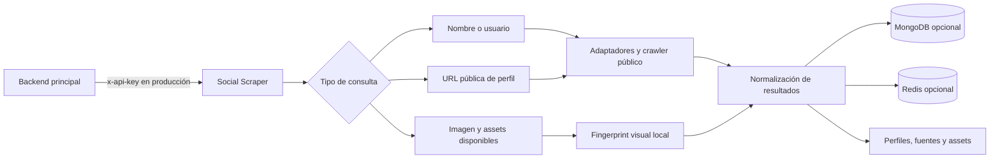

# Reverse Image Engine — OSINT Deco · Scraper social

[](LICENSE)


Microservicio NestJS que descubre, resuelve y normaliza perfiles públicos. Incluye crawlers/adaptadores por plataforma, búsqueda de perfiles por nombre o usuario, resolución de URL y búsqueda visual contra assets guardados localmente.

**Desarrollado y publicado por [deco31416.com](https://deco31416.com).** Licencia MIT: [LICENSE](LICENSE).

## Cómo funciona



## Endpoints principales

Base local: `http://localhost:7110/api/v1`.

| Método | Ruta | Uso |
| --- | --- | --- |
| GET | `/health` | Estado y disponibilidad de configuración |
| GET | `/social/platforms` | Plataformas/adaptadores registrados |
| POST | `/social/search/username` | Buscar por nombre de usuario |
| POST | `/social/search/name` | Buscar por nombre |
| POST | `/social/search/image` | Comparar con assets visuales disponibles |
| POST | `/social/profile/resolve` | Resolver URL pública de perfil |
| GET | `/assets`, `/assets/:id` | Consultar assets guardados |
| PATCH | `/assets/:id/status` | Clasificar un asset |

Usa el prefijo `/api/v1` para todas las rutas.

Ejemplo de búsqueda:

```json
{
  "username": "public_handle",
  "platforms": ["github", "reddit", "instagram"],
  "limit": 10
}
```

La cobertura depende de cada adaptador y de los límites de los sitios. RapidAPI es una integración opcional; sin sus claves, las rutas compatibles con crawlers públicos pueden seguir funcionando con cobertura reducida. No se garantiza que todas las redes permitan scraping o devuelvan resultados.

## Desarrollo local

Requiere Node.js 20+ y Yarn 4. Desde la raíz del monorepo:

```powershell
cd .\osint-social-scraper
yarn install
Copy-Item .env.example .env
yarn start:dev
```

Variables opcionales importantes:

- `SOCIAL_SCRAPER_API_KEY` o `MICROSERVICES_API_KEY`: autenticación entre servicios. En producción se requiere una clave interna.
- `REDIS_URL`: caché opcional.
- `MONGODB_URI`: persistencia opcional del scraper.
- `UPLOAD_DIR`, `UPLOAD_PUBLIC_BASE_URL`: almacenamiento local/volumen y URL pública de assets.
- Claves `RAPIDAPI_*`: proveedores opcionales por plataforma.

Genera tus propios secretos. No uses los valores de ejemplo en producción. Revisa [.env.example](.env.example) y [docs/LOCAL-Y-RAILWAY.md](docs/LOCAL-Y-RAILWAY.md).

## Desarrollo y calidad

```powershell
yarn build
yarn test
```

Añade o cambia plataformas mediante adaptadores separados. Documenta límites, fuentes y requisitos de clave; conserva la URL de procedencia y diferencia resultados observados de inferencias.

## Uso responsable y licencia

Recopila solo información pública necesaria para investigaciones autorizadas. Respeta las leyes y condiciones de los sitios consultados; los usuarios son responsables del uso que hagan de los datos.

MIT por [deco31416.com](https://deco31416.com). Consulta [LICENSE](LICENSE); proveedores y dependencias externas mantienen sus propias condiciones.